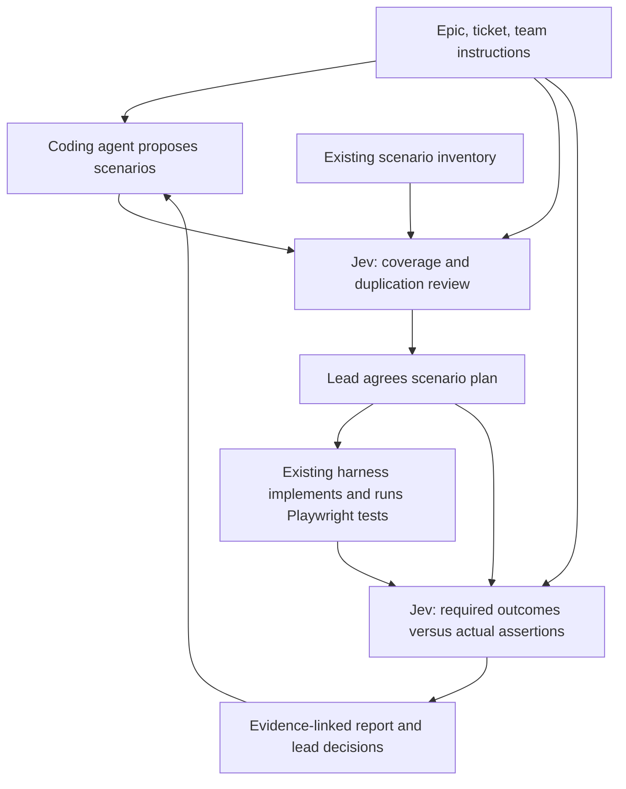
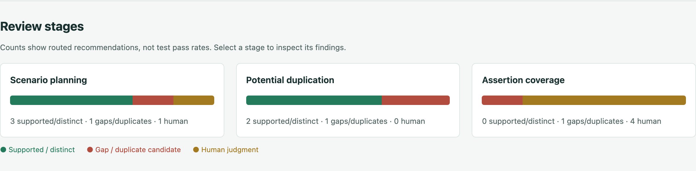

# Jev Scope QA — scenario evaluator

An advisory review layer for QA leads and principal engineers working with an
existing Playwright agentic harness. Copilot, Claude or another coding agent
produces scenarios and tests. Jev evaluates narrow quality questions against the
supplied evidence; the lead decides what to accept, revise or clarify.

## Daily workflow



**Stage 1 — scenario planning:** compare every acceptance criterion with the
supplied existing and proposed inventory. Evaluate every unique scenario pair
within the work item for potential behavioral duplication. Different roles,
boundaries, preconditions or expected outcomes can justify similar scenarios.

**Stage 2 — implementation:** compare each criterion with the agreed plan and
actual test/helper code. A passing run that checks only a page heading does not
verify access denial. Conversely, adequate assertions can exist in a failing
test: execution and coverage are separate facts.

The layer does not generate or execute Playwright tests, edit the harness,
consolidate duplicates, or approve releases. All browser automation remains in
the existing harness. New code and dependencies are confined to this directory.

## Explore without an API key

```bash
git clone https://github.com/balajiregt/jev-scope-qa.git
cd jev-scope-qa
npm ci
npm run report:sample
npm run report:serve
```

Open http://127.0.0.1:8791/sample-report.html for the historical live result over
synthetic inputs. It is not a new model run. The report includes all 13 findings,
the two benchmark disagreements and evidence details. `npm run review:preview`
provides a separate offline view of the outgoing evaluation packets.



## Quick start

Use Node.js 22+ in this folder. Keep your existing key in `.env.local`:

```text
AI_GATEWAY_API_KEY=your-key
JEV_MIN_PROBABILITY=0.80
```

```bash
npm ci
npm run typecheck
npm test

# Offline: inspect exact outbound packets and a report with no invented answers.
npm run review:preview

# Live: 13 checks on synthetic examples with independent expected labels.
npm run review:benchmark

# Rebuild saved reports without calling the API.
npm run report:build
npm run report:serve
```

Open http://127.0.0.1:8791/. You can also open `artifacts/index.html` directly.
The report embeds its assets and makes no external requests. Only the artifacts
directory is served; the credential file is outside it. Artifacts contain evidence
and should be shared only with intended reviewers.

`review:benchmark` deliberately returns exit code 1 for any exact finding/gold
mismatch or operational failure. Inspect results rather than altering labels to
make the benchmark pass. See [VALIDATION.md](VALIDATION.md) for recorded results.

Live requests use `experimental_evaluate` from AI SDK, `typesafe-ai/jev`, and
`AI_GATEWAY_API_KEY` from the process environment or this project's `.env.local`.
Access is subject to Vercel billing/quota rules; promotional availability is not
assumed. The SDK API is experimental and the dependency is pinned.

## Review a real work item

Copy `examples/lead-review.json` to `examples/my-review.json` and replace its
synthetic content with a normalized export from your agent/harness. The file is
an array of work items. Its fields are:

| Field | What to provide |
| --- | --- |
| `id`, `title` | Local review identity and readable title |
| `sources` | Separate epic, ticket, instructions and developer-scope records with actual text |
| `criteria` | Explicit criterion text and valid `sourceIds`; do not silently invent requirements |
| `inventoryComplete` | Whether this is the complete scenario inventory for the declared scope |
| `scenarios` | Existing/proposed status, role, preconditions, actions, expected outcomes and criterion links |
| `approvedScenarioIds` | Scenario IDs actually agreed by the lead; leave empty before agreement |
| `implementationEvidenceComplete` | Whether relevant tests and referenced helper implementations are fully supplied |
| `implementations` | Test location, actual code, helper code, scenario links and a supplied run record |

Keep each work item bounded. Duplicate comparisons are within a work item, not
across the whole organization. To compare an existing test with a new proposal,
include both in the same work item's inventory. All unique pairs are evaluated;
there is no title-only filter or silent truncation. Large inventories must be
split deliberately, with any cross-batch comparison gaps recorded by the reviewer.

```bash
# Before implementation: planning and pair comparisons can be run separately.
npm run review:preview -- --input examples/my-review.json --stage planning
npm run review:live -- --input examples/my-review.json --stage planning
npm run review:live -- --input examples/my-review.json --stage duplication

# After lead agreement, code generation and the normal Playwright run:
npm run review:preview -- --input examples/my-review.json --stage implementation
npm run review:live -- --input examples/my-review.json --stage implementation

# Or review both stages and all pairs together:
npm run review:live -- --input examples/my-review.json
```

A live command sends the selected packets' source text and code to
Vercel/TypeSafe. Preview first and use evidence you are authorized to export.
There is no Jira connector, automatic repo crawler, automatic source extraction
or automatic Playwright-result import in v2. The agent/harness supplies the
normalized snapshot; [agent-handoff.md](docs/agent-handoff.md) describes that boundary.
Locations and scenario links aid the human reviewer but are not proof of coverage.
The evaluator reads all supplied inventory/code for a criterion, rather than
trusting claimed criterion links.

## Findings and lead review

| Model finding | Routed recommendation at sufficient probability |
| --- | --- |
| `supported` | Positive: supplied stage evidence supports the criterion |
| `distinct` | Positive: scenarios cover materially different behavior |
| `coverage_gap` | Negative: complete scenario inventory omits necessary coverage |
| `assertion_gap` | Negative: actual implementation lacks the necessary assertion |
| `duplicate_candidate` | Negative: lead should review possible duplication |
| `ambiguous_scope` | Neutral: clarify requirements or conflicting scope |
| `insufficient_evidence` | Neutral: supply missing inventory, code or helper evidence |

Each check asks **one Choice question**. The finding determines the recommendation
and local explanatory template, avoiding v1's independent verdict/reason conflicts.
Selected finding probability below `JEV_MIN_PROBABILITY` routes to human judgment
without changing the raw model answer. The default 0.80 is provisional, not a
calibrated correctness guarantee. The model is still fallible at high probability.

The report provides:

- Stage graphs with supported, flagged and human-review counts.
- A criterion → claimed scenario links → planning/implementation matrix.
- Pairwise duplication findings and the exact scenarios compared.
- Expandable requirements, scenarios, code, helper and run evidence.
- Raw findings, distributions, routing reasons and separate operational errors.
- Local-only gold expectations for benchmark runs; no accuracy claim for real reviews.
- A reviewer form for approve, request changes, clarify or dismiss with rationale.

The reviewer form **downloads** a decision JSON; it does not silently save an
approval. Save it in `artifacts/` and run the import command shown in the report:

```bash
npm run review:decision -- --report artifacts/lead-review.json --decision-file artifacts/decision-RUNPREFIX.json
```

Then reload. Imports append reviewer history, leave model answers unchanged and
reject a mismatched run ID or unknown check. Reviewer identity is self-declared;
this local tool is not an authenticated approval service. A reviewer decision
applies to one check, not the whole ticket. A fresh evaluation starts with no
reviewer approvals; previous run snapshots remain in `artifacts/history/`.

## Evaluation boundaries

`examples/lead-review.json` contains synthetic examples of adequate coverage,
a passing but ineffective test, a missing editor scenario, duplicates versus
different roles, undefined export permissions and a missing assertion helper.
All embedded browser execution records are illustrative; no browser tests were
executed to create those records. The live model calls are real.

`fixtures/workflow-gold.json` contains independent expected findings. Gold labels,
rationale, local benchmark IDs, filenames and reviewer decisions never enter the
model request. Reports retain input hashes, request hashes, rubric version and
exact packets. Input schemas validate unique IDs and references before model calls.
Each packet is capped at 80 KB and each run at 100 requests. Calls have a 30-second
timeout and no automatic retries; configuration/auth/quota failures stop remaining
calls, which are marked not run rather than neutral.

A small synthetic benchmark validates an experiment, not production reliability.
Add independently reviewed real tickets, hard near-duplicates and held-out cases
before relying on this layer for release decisions. Incomplete input limits what
the model can judge; an inventory completeness flag is supplied metadata, not an
automatically verified fact.

## Project layout and previous experiment

- `src/workflow.ts`: v2 schema, request construction, rubric, routing and reviewer history.
- `src/workflow-cli.ts`: preview, live review, benchmark and decision import.
- `src/lead-*`: standalone graph report and interactive evidence explorer.
- `examples/lead-review.json`: agent/harness input contract example.
- `fixtures/workflow-gold.json`: local-only evaluation labels.
- `tests/workflow.test.ts`: meaningful boundary and regression checks.

The original v1 experiment and its saved nine-case results are retained for
comparison, not presented as v2 results. Existing `eval:*` commands use v1;
`review:*` commands use v2. `report:build` places v1 graphs at
`artifacts/legacy-report.html` and the new lead report at `artifacts/index.html`.
See [legacy-v1.md](docs/legacy-v1.md) for the old commands and read-only CRM adapter.
The old central UI resolver still targets the missing `projects/ui-automation`
location. It was not modified by this rebuild.

References: [TypeSafe use-case map](https://docs.typesafe.ai/concepts/use-case-map),
[Vercel AI SDK](https://vercel.com/docs/ai-gateway/sdks-and-apis/ai-sdk).


## Standalone use and optional local integration

The v2 workflow, default tests, previews and sample report work without a sibling
Playwright repository. One optional legacy CRM integration test is skipped when
`contexts/harness.local.yml` is absent. To use that old adapter, copy
`contexts/harness.yml` to the ignored `contexts/harness.local.yml`, then configure
the harness path, explicit evidence files and credential path locally. Do not
commit that local file or repository evidence. CI runs offline checks only; it
does not use an API key or invoke Jev.

## Project story

[Medium article draft](docs/blog/medium-article.md) ·
[LinkedIn post draft](docs/blog/linkedin-post.md) ·
[Publication notes](docs/blog/publication-notes.md).

## Controlled benchmark instrumentation

See [benchmark protocol and validation](benchmarks/README.md) for reproducible synthetic tasks, measured evidence, missing metrics and claim limitations.
